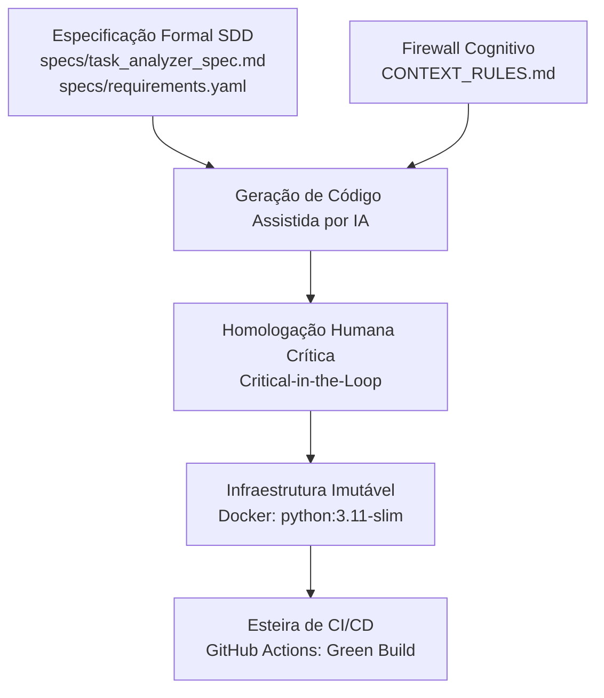

# sdd-task-analyzer — Analisador de Tarefas Orientado por Especificação (SDD)

[](https://github.com/Merketz/sdd-task-analyzer/actions/workflows/ci.yml)


-brightgreen)


Repositório oficial da **Entrega da Etapa Final (Fase 3)** da disciplina de **Engenharia de Software (UniCEUB)**, aplicando a metodologia **Specification-Driven Development (SDD)** combinada com esteira de **CI/CD (GitHub Actions)**, **Containerização Imutável (Docker e Docker Compose)** e **Governança Ética de Inteligência Artificial** para construção e validação de um motor de análise de métricas de tarefas (`TaskAnalyzer`).

---

## Identificação Acadêmica
- **Aluno:** Marco Antonio Rodrigues
- **Curso:** Bacharelado em Engenharia de Software
- **Polo / Turma:** Asa Norte — UniCEUB
- **E-mail:** marco.rodrigues@sempreceub.com
- **Repositório GitHub:** [https://github.com/Merketz/sdd-task-analyzer](https://github.com/Merketz/sdd-task-analyzer)

---

## 1. Visão Geral da Arquitetura SDD & DevOps
No paradigma **Desenvolvimento Orientado por Especificação (SDD)** integrado à cultura DevOps, os contratos formais e as regras de contexto atuam como a fonte única da verdade (*Single Source of Truth*) antes de qualquer geração de código ou automação:

1. **Governança e Guardrails (`CONTEXT_RULES.md`):** Firewall cognitivo que define restrições arquiteturais estritas: uso exclusivo da biblioteca padrão do Python (proibição de `pandas`/`numpy`), tipagem estática moderna PEP 604 (`X | Y`, `list[...]`, `dict[...]`), Google Style Docstrings, módulo nativo `logging` e hierarquia própria de exceções de domínio.
2. **Especificação Técnica Executável (`specs/task_analyzer_spec.md` & `specs/requirements.yaml`):** Formaliza contratos de entrada e saída, invariantes cronológicas e cenários BDD (*Dado-Quando-Então*).
3. **Implementação (`src/`):** Código puro em memória (*stateless in-memory*), modular e aderente ao Princípio de Responsabilidade Única (SRP).
4. **Test Harness (`tests/test_harness.py`):** Suíte automatizada em `pytest` validando casos nominais, rejeição de inconsistências temporais e prevenção contra `ZeroDivisionError`.
5. **Containerização Hermética (`Dockerfile` & `docker-compose.yml`):** Ambiente reproduzível baseado em `python:3.11-slim` que elimina variações de ambiente operacional.
6. **Integração Contínua (`.github/workflows/ci.yml`):** Pipeline no GitHub Actions disparado a cada `push` e `pull_request` nas branches `main` e `develop`.

---

## 2. Estrutura do Repositório (Arquitetura Final)

```text
sdd-task-analyzer/
├── .github/
│   └── workflows/
│       └── ci.yml
├── Dockerfile
├── docker-compose.yml
├── .dockerignore
├── CONTEXT_RULES.md
├── specs/
│   ├── task_analyzer_spec.md
│   └── requirements.yaml
├── tests/
│   ├── __init__.py
│   └── test_harness.py
├── src/
│   ├── __init__.py
│   ├── exceptions.py
│   └── task_analyzer.py
├── requirements.txt
├── README.md
├── RELATORIO_FASE2.md
└── RELATORIO_FASE3_GOVERNANCA_ETICA.md
```

---

## 3. Regras de Negócio e Contratos

### Entradas (`list[dict[str, Any]]`)
Cada tarefa possui:
- `id` (`str | int`, obrigatório): Identificador único.
- `titulo` (`str`, obrigatório): Não nulo e não vazio.
- `prioridade` (`str`, obrigatório): `'BAIXA'`, `'MEDIA'` ou `'ALTA'`.
- `data_criacao` (`datetime | str` ISO 8601, obrigatório).
- `data_limite` (`datetime | str` ISO 8601, obrigatório): Deve ser `>= data_criacao`.
- `data_conclusao` (`datetime | str` ISO 8601 `| None`, opcional): Obrigatório quando `status == 'CONCLUIDA'`. Deve ser `>= data_criacao`.
- `status` (`str`, obrigatório): `'PENDENTE'`, `'EM_ANDAMENTO'`, `'CONCLUIDA'` ou `'CANCELADA'`.

### Saídas (`dict[str, Any]`)
- `total_tarefas` (`int`): Total de tarefas recebidas no lote.
- `tarefas_concluidas` (`int`) e `total_concluidas` (`int`): Total de tarefas com `status == 'CONCLUIDA'`.
- `total_pendentes` (`int`): Total de tarefas não concluídas.
- `tempo_medio_conclusao_horas` (`float`): Média em horas (arredondada em 2 casas decimais) entre `data_criacao` e `data_conclusao` das tarefas concluídas (`0.0` quando não há concluídas).
- `taxa_atraso_percentual` (`float`): Percentual (arredondado em 2 casas decimais) de tarefas concluídas com `data_conclusao > data_limite` (`0.0` quando não há concluídas).
- `metricas_por_prioridade` (`dict[str, dict[str, int | float]]`): Métricas segmentadas para `'BAIXA'`, `'MEDIA'` e `'ALTA'`.

---

## 4. Instruções de Execução

### 4.1. Execução via Docker (Recomendado — Ambiente Isolado)
Para compilar a imagem e executar o Test Harness em contêiner descartável:
```bash
docker build -t task-analyzer .
docker run --rm task-analyzer
```

### 4.2. Execução via Docker Compose (Comando Único)
Para executar a suíte com o serviço orquestrado `task-analyzer-tests`:
```bash
docker compose run --rm task-analyzer-tests
```

### 4.3. Execução em Ambiente Virtual Local (Python 3.11+ / 3.14)
```bash
# Criação do ambiente virtual
python -m venv .venv
source .venv/bin/activate

# Instalação das dependências
pip install -r requirements.txt

# Execução do Test Harness
pytest tests/test_harness.py -v
```

### 4.4. Status dos Testes Homologados
| Caso de Teste (`tests/test_harness.py`) | Cenário SDD | Status |
| :--- | :--- | :---: |
| `test_analyze_valid_tasks_returns_correct_metrics` | Cenário 1: Lote válido (4 tarefas, médias e prioridades) | PASSED |
| `test_analyze_inconsistent_dates_raises_exception` | Cenário 2: Datas inconsistentes (`InconsistentDatesError`) | PASSED |
| `test_analyze_empty_payload_raises_error` | Cenário 3: Lote vazio estrito (`EmptyDatasetError`) | PASSED |
| `test_analyze_empty_and_only_pending_tasks_returns_zero_metrics` | Caso de Borda: Prevenção de `ZeroDivisionError` (`0.0`) | PASSED |
| `test_analyze_supports_iso_strings_and_datetime_objects` | Entradas híbridas (`str` ISO 8601 e `datetime`) | PASSED |

---

## 5. Arquitetura da Confiança (DevOps + SDD + Governança Ética)

A **Arquitetura da Confiança** representa o entrelaçamento sistemático de quatro pilares de engenharia moderna:



1. **Especificação como Contrato Executável:** Elimina ambiguidades funcionais ao formalizar pré-condições, pós-condições e cenários BDD antes da escrita de qualquer linha de código.
2. **Firewall Cognitivo Anti-Alucinação:** O arquivo `CONTEXT_RULES.md` impede desvios arquiteturais comuns de LLMs, como a injeção não autorizada de bibliotecas pesadas (`pandas`, `numpy`) ou mutações em assinaturas de API.
3. **Engenheiro no Circuito (Critical-in-the-Loop):** A homologação técnica humana atua na revisão e identificação de casos de borda matemáticos e de integridade temporal (como divisão por zero e consistência cronológica com rastreamento do ID violador).
4. **Infraestrutura Hermética e Imutável:** Contêineres Docker e pipelines de CI no GitHub Actions garantem determinismo operacional, assegurando que o código aprovado execute com idêntico comportamento em desenvolvimento local, no runner da nuvem e em produção.
