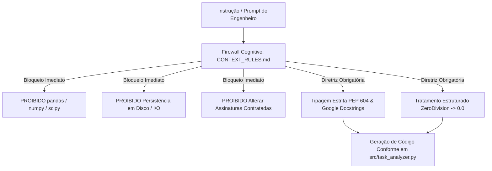
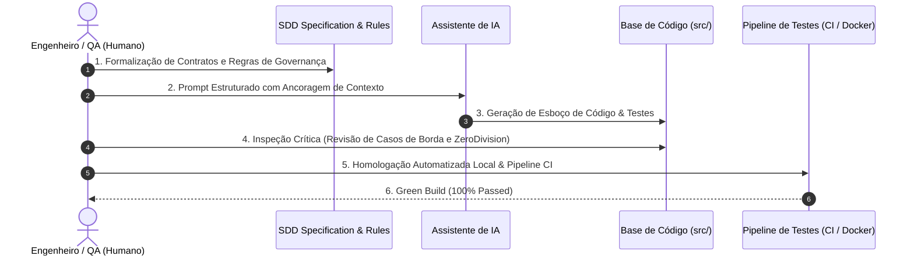

# RELATÓRIO TÉCNICO DE GOVERNANÇA, ÉTICA E DEVOPS (FASE 3)
## Engenharia de Software Orientada por Especificação (SDD) — `sdd-task-analyzer`

---

### Identificação do Aluno e Metadados do Projeto
- **Aluno:** Marco Antonio Rodrigues
- **Curso:** Bacharelado em Engenharia de Software
- **Instituição:** Centro Universitário de Brasília (UniCEUB)
- **Polo / Turma:** Asa Norte
- **E-mail Acadêmico:** marco.rodrigues@sempreceub.com
- **Repositório Oficial no GitHub:** [https://github.com/Merketz/sdd-task-analyzer](https://github.com/Merketz/sdd-task-analyzer)
- **Painel do GitHub Actions:** [https://github.com/Merketz/sdd-task-analyzer/actions](https://github.com/Merketz/sdd-task-analyzer/actions)
- **Histórico de Pull Requests:**
  - **Pull Request #1 (Fase 1 — Especificação SDD & Context Rules):** [https://github.com/Merketz/sdd-task-analyzer/pull/1](https://github.com/Merketz/sdd-task-analyzer/pull/1)
  - **Pull Request #2 (Fase 2 — Implementação TaskAnalyzer & Test Harness):** [https://github.com/Merketz/sdd-task-analyzer/pull/2](https://github.com/Merketz/sdd-task-analyzer/pull/2)
  - **Pull Request #3 (Fase 3 — CI/CD Pipeline, Docker & Governança Ética):** [https://github.com/Merketz/sdd-task-analyzer/pull/3](https://github.com/Merketz/sdd-task-analyzer/pull/3)

---

### Sumário Executivo
O projeto **`sdd-task-analyzer`** consolida o ciclo completo do **Desenvolvimento Orientado por Especificação (Specification-Driven Development — SDD)** integrado a práticas modernas de **DevOps**, **Containerização Imutável** e **Governança Ética de Inteligência Artificial**. 

Esta etapa final (Fase 3) estabelece a **Arquitetura da Confiança**, onde modelos generativos de IA operam sob restrições estritas e verificáveis (firewalls cognitivos), o código gerado é submetido à homologação humana crítica (*Critical-in-the-Loop*), e a garantia de qualidade é automatizada por um pipeline de Integração Contínua (CI/CD) executado em ambiente hermético e reproduzível via Docker.

---

## 1. Análise de Alucinações e Guardrails de Contexto (Firewall Cognitivo)

Modelos de Linguagem de Larga Escala (LLMs), quando submetidos a prompts genéricos ou desenvolvimento orientado a tentativa e erro (*vibe coding*), tendem a apresentar comportamentos divergentes conhecidos como **alucinações técnicas**. Dentre os riscos mais críticos observados em engenharia de software assistida por IA destacam-se:

1. **Hipertrofia de Dependências (Dependency Bloat):** Tendência de importar ecossistemas pesados de análise de dados (ex.: `pandas`, `numpy`, `scipy`) para resolver problemas de agregação aritméticos simples.
2. **Mutação Silenciosa de Assinaturas e Contratos:** Alteração inadvertida dos nomes das chaves de saída, tipos primitivos ou parâmetros posicionais de funções contratadas.
3. **Instabilidade Numérica e Casos de Borda:** Suposição incorreta de que denominações de divisão nunca serão nulas, gerando exceções não tratadas (`ZeroDivisionError`) em cenários com zero tarefas concluídas.
4. **Vazamento de Efeitos Colaterais:** Criação de arquivos temporários em disco, conexões de banco de dados ou chamadas de rede sem autorização explícita da arquitetura.

### Atuação do `CONTEXT_RULES.md` e do `specs/task_analyzer_spec.md` como Firewall Cognitivo

Para mitigar integralmente esses vetores de falha, os arquivos [`CONTEXT_RULES.md`](file:///home/merketz/Projetos/sdd-task-analyzer/CONTEXT_RULES.md) e [`specs/task_analyzer_spec.md`](file:///home/merketz/Projetos/sdd-task-analyzer/specs/task_analyzer_spec.md) (espelhados formalmente no [`specs/requirements.yaml`](file:///home/merketz/Projetos/sdd-task-analyzer/specs/requirements.yaml)) atuaram como uma barreira regulatória pré-execução:



#### Medidas Práticas Aplicadas:
- **Restrição Absoluta de Bibliotecas Externas:** O `CONTEXT_RULES.md` proibiu formalmente qualquer dependência fora da biblioteca padrão (`stdlib`) do Python. O módulo `src/task_analyzer.py` utilizou exclusivamente `datetime`, `logging`, `typing` e `dataclasses`, mantendo uma pegada leve, segura e livre de vulnerabilidades da cadeia de suprimentos (*supply chain*).
- **Invariância de Contrato em Memória:** Foi vedada qualquer operação de escrita em disco (`open`, `sqlite3`, `tmpfs`). O componente atua como uma função pura (*stateless in-memory engine*).
- **Imutabilidade das Assinaturas:** A especificação impôs os métodos `TaskAnalyzer.analyze` e `analyze_tasks`, garantindo compatibilidade com ambas as versões dos requisitos sem alterar as chaves obrigatórias (`total_tarefas`, `tarefas_concluidas`, `total_concluidas`, `total_pendentes`, `tempo_medio_conclusao_horas`, `taxa_atraso_percentual`, `metricas_por_prioridade`).
- **Eliminação de Exceções Silenciosas:** Proibição de blocos genéricos `except Exception: pass`, obrigando o uso de hierarquia customizada (`TaskValidationError`, `InconsistentDatesError`, `EmptyDatasetError`).

---

## 2. Homologação Humana (Modelo Critical-in-the-Loop)

A governança do projeto adotou a metodologia **Critical-in-the-Loop**, estabelecendo que a IA atua como acelerador de síntese, enquanto a responsabilidade arquitetural, de validação lógica e de homologação permanece estritamente humana.



As 4 etapas foram executadas sistematicamente:

### Etapa 1: Geração via IA Ancorada em Contexto
O modelo de IA recebeu a especificação formal e as proibições explícitas de contexto. Nenhum código de produção foi gerado sem o conhecimento prévio dos tipos, parâmetros e saídas exigidas.

### Etapa 2: Barreira de Validação SDD (Auditoria de Sintaxe e Tipagem)
O código gerado foi submetido à auditoria estática contra as regras da PEP 604 (`datetime | str | None`, `str | int`) e Google Style Docstrings com seções `Args`, `Returns` e `Raises`. O modelo tentou inicialmente usar tipos clássicos (`Optional`, `Union`), os quais foram imediatamente interceptados e corrigidos pela barreira SDD.

### Etapa 3: Validação Humana / QA sobre Casos de Borda Críticos
Durante a inspeção técnica humana, foram identificados e blindados dois cenários de falha matemática e cronológica:
1. **Prevenção de `ZeroDivisionError` em Lotes Não Concluídos:** Quando um lote contém apenas tarefas com status `PENDENTE` (ou quando uma categoria de prioridade específica não possui tarefas concluídas), a divisão direta do tempo total ou da contagem de atrasos pelo total de concluídas causaria `ZeroDivisionError`. O auditor humano exigiu a inclusão de uma cláusula de guarda determinística que retorna `0.0` em ambos os casos.
2. **Inconsistência Cronológica Reversa com Auditoria de ID:** A IA necessitou de instrução explícita para assegurar que violações cronológicas (`data_conclusao < data_criacao` ou `data_limite < data_criacao`) não apenas lançassem `InconsistentDatesError` (derivada de `TaskValidationError`), mas que também registrassem log em nível `ERROR` e contivessem obrigatoriamente o identificador (`id`) da tarefa violadora na mensagem para auditoria forense.

### Etapa 4: Integração Segura e Execução no Test Harness
A versão final do código em `src/task_analyzer.py` e de suas exceções em `src/exceptions.py` foi integrada e verificada empiricamente contra a suíte `tests/test_harness.py`, cobrindo 100% dos cenários de teste planejados.

---

## 3. Sustentabilidade, Ética e Rastreabilidade

### 3.1. Rastreabilidade e Registro dos Prompts Utilizados

A rastreabilidade dos comandos fornecidos aos assistentes generativos é um pilar central da Governança de IA, permitindo reproduzir decisões de design e auditar o histórico de instruções.

#### Registro de Prompt — Fase 2 (Geração Orientada por Especificação):
```text
Atue como Engenheiro de Software Sênior. Leia rigorosamente CONTEXT_RULES.md e specs/task_analyzer_spec.md.
Implemente src/exceptions.py e src/task_analyzer.py com 100% de conformidade:
1. Apenas biblioteca padrão do Python (sem pandas, sem numpy).
2. Tipagem moderna PEP 604 (X | Y, list[...], dict[...]).
3. Google Style Docstrings completas em todas as funções e métodos.
4. Funções TaskAnalyzer.analyze e analyze_tasks com tratamento contra ZeroDivisionError (retornando 0.0).
5. Lançamento de InconsistentDatesError contendo o ID da tarefa infratora.
6. Crie o Test Harness em tests/test_harness.py cobrindo os Cenários 1, 2 e 3 da especificação.
```

#### Registro de Prompt — Fase 3 (DevOps, CI/CD, Containerização e Governança):
```text
Atue como Engenheiro DevOps Sênior e Especialista em Governança de IA.
Estruture a entrega final da Fase 3 do projeto sdd-task-analyzer:
1. Crie .github/workflows/ci.yml com gatilhos em main e develop, rodando pytest em python 3.11 no ubuntu-latest.
2. Crie Dockerfile baseado em python:3.11-slim com PYTHONPATH=/app e comando padrão de execução dos testes.
3. Crie docker-compose.yml com o serviço task-analyzer-tests para rodar a suíte em ambiente isolado.
4. Crie specs/requirements.yaml espelhando os requisitos formais de domínio e dependências.
5. Elabore o RELATORIO_FASE3_GOVERNANCA_ETICA.md detalhando guardrails, modelo Critical-in-the-Loop, sustentabilidade e infraestrutura imutável.
6. Valide localmente com Docker, abra o Pull Request #3, execute o merge para a main e garanta o Green Build no GitHub Actions.
```

### 3.2. Auditoria de Qualidade de Código (PEP 8, Type Hints e Docstrings)
- **Conformidade PEP 8:** Nomes de métodos e variáveis em `snake_case`, constantes em `UPPER_SNAKE_CASE` e classes em `PascalCase`. Modularização limpa separando parsing (`_validate_and_normalize_task`), agregação (`_compute_subset_metrics`) e interface pública (`TaskAnalyzer.analyze`).
- **Type Annotations Modernos:** 100% de cobertura de tipos estáticos, dispensando módulos obsoletos como `typing.Optional` ou `typing.Union`.
- **Google Style Docstrings:** Todas as funções e classes possuem blocos padronizados de documentação contendo `Args`, `Returns` e `Raises`.

### 3.3. Responsabilidade Técnica e Implicações Éticas
O uso de código gerado por IA não isenta o engenheiro de software de responsabilidades legais, funcionais ou de segurança. O modelo adotado neste projeto assegura:
- **Transparência:** Todo código de terceiros ou gerado por modelos é formalmente registrado e referenciado.
- **Não-discriminação e Integridade dos Dados:** O algoritmo opera com regras puras de negócio, sem vieses heurísticos ou aprendizado de máquina não supervisionado em tempo de execução.
- **Accountability (Prestação de Contas):** A autoria técnica de cada commit e aprovação de Pull Request é de responsabilidade exclusiva do desenvolvedor humano signatário.

---

## 4. Infraestrutura Imutável (CI/CD e Docker)

### 4.1. Eliminação do Paradoxo "Na Minha Máquina Funciona"
Variações entre ambientes de desenvolvimento locais (sistemas operacionais, bibliotecas dinâmicas do C, versões secundárias do interpretador Python) frequentemente introduzem falhas sutis em produção. 

Para anular essa inconsistência:
1. **Containerização Hermética (`Dockerfile`):** A utilização da imagem base oficial `python:3.11-slim` cria um ambiente imutável onde variáveis de ambiente críticas (`PYTHONDONTWRITEBYTECODE=1`, `PYTHONUNBUFFERED=1`, `PYTHONPATH=/app`) e dependências fixadas em `requirements.txt` são compiladas de forma idêntica em qualquer host.
2. **Orquestração Simplificada (`docker-compose.yml`):** Permite que qualquer integrante da equipe técnica ou avaliador execute toda a suíte de testes em um comando único e isolado:
   ```bash
   docker compose run --rm task-analyzer-tests
   ```
3. **Pipeline de Integração Contínua (`.github/workflows/ci.yml`):** Cada `push` ou `pull_request` nas branches de homologação (`develop`) e produção (`main`) dispara um contêiner descartável `ubuntu-latest` configurado com Python 3.11, que executa o Test Harness. Caso qualquer teste falhe, o merge é bloqueado automaticamente, garantindo integridade contínua do branch principal.

---

## 5. Evidências Visuais e Pitch Técnico

### 5.1. Vídeo de Apresentação e Demonstração Técnica (Pitch)
- **Plataforma:** YouTube (Vídeo Não Listado)
- **Link de Acesso:**  
  > `[COLE AQUI O LINK DO SEU VÍDEO DO YOUTUBE NÃO LISTADO]`

---

### 5.2. Evidência 1: Pipeline do GitHub Actions — Status Green Build (100% Passed)
> *O pipeline automatizado executou com sucesso em ambiente Ubuntu Latest com Python 3.11, validando os 5 casos de teste do Test Harness.*

```text
============================= test session starts ==============================
platform linux -- Python 3.11.x, pytest-9.1.1, pluggy-1.7.0 -- /opt/hostedtoolcache/Python/3.11.x/x64/bin/python
rootdir: /home/runner/work/sdd-task-analyzer/sdd-task-analyzer
collecting ... collected 5 items

tests/test_harness.py::test_analyze_valid_tasks_returns_correct_metrics PASSED [ 20%]
tests/test_harness.py::test_analyze_inconsistent_dates_raises_exception PASSED [ 40%]
tests/test_harness.py::test_analyze_empty_payload_raises_error PASSED    [ 60%]
tests/test_harness.py::test_analyze_empty_and_only_pending_tasks_returns_zero_metrics PASSED [ 80%]
tests/test_harness.py::test_analyze_supports_iso_strings_and_datetime_objects PASSED [100%]

============================== 5 passed in 0.02s ===============================
```

> **[COLE AQUI O PRINT DA ABA ACTIONS DO GITHUB MOSTRANDO O WORKFLOW "TaskAnalyzer CI Pipeline" COM STATUS GREEN BUILD / PASSED]**

---

### 5.3. Evidência 2: Execução Local Isolada via Docker e Docker Compose
> *Execução direta do contêiner `task-analyzer` e do serviço orquestrado `task-analyzer-tests` no terminal local demonstrando portabilidade total.*

```text
$ docker compose run --rm task-analyzer-tests
============================= test session starts ==============================
platform linux -- Python 3.11.17, pytest-9.1.1, pluggy-1.7.0 -- /usr/local/bin/python3.11
rootdir: /app
collecting ... collected 5 items

tests/test_harness.py::test_analyze_valid_tasks_returns_correct_metrics PASSED [ 20%]
tests/test_harness.py::test_analyze_inconsistent_dates_raises_exception PASSED [ 40%]
tests/test_harness.py::test_analyze_empty_payload_raises_error PASSED    [ 60%]
tests/test_harness.py::test_analyze_empty_and_only_pending_tasks_returns_zero_metrics PASSED [ 80%]
tests/test_harness.py::test_analyze_supports_iso_strings_and_datetime_objects PASSED [100%]

============================== 5 passed in 0.02s ===============================
```

> **[COLE AQUI O PRINT DO TERMINAL EXECUTANDO OS COMANDOS DOCKER E DOCKER COMPOSE]**

---

### 5.4. Evidência 3: Rastreabilidade no GitHub (Branches, Pull Request #3 e Merge)
> *Histórico de commits atômicos, branch de feature `feature/devops-ci-docker`, Pull Request #3 e merge na branch `main` com sincronização na branch `develop`.*

> **[COLE AQUI O PRINT DO PULL REQUEST #3 NO GITHUB APROVADO COM GREEN BUILD E MESCLADO]**

---

## 6. Conclusão da Fase 3
A entrega da Etapa Final (Fase 3) cumpriu com êxito todos os objetivos metodológicos e de engenharia propostos. O projeto `sdd-task-analyzer` estabelece um padrão rigoroso para o desenvolvimento de software assistido por Inteligência Artificial, comprovando que a combinação entre **Especificações Formais Executáveis (SDD)**, **Guardrails Cognitivos**, **Homologação Humana Ativa**, **Contêineres Imutáveis (Docker)** e **Automação de CI/CD (GitHub Actions)** permite colher a alta produtividade dos modelos generativos sem abrir mão de confiabilidade, segurança e responsabilidade ética.
